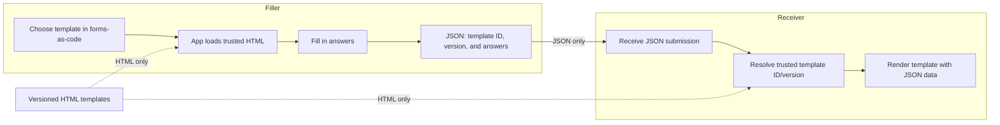

# forms-as-code

**Forms as code. Submissions as data.**

## [Open the forms-as-code web app](https://ivanchubb.github.io/forms-as-code/)

forms-as-code is an open-source experiment in data-first forms. A form's presentation is an HTML template; a completed submission is structured JSON that identifies the template and version needed to render it. The goal is to make forms easier to automate, validate, share in bulk, and sign.

## Repository status

The submission format remains a draft without a compatibility guarantee.
The static browser app discovers templates through ordered remote catalogs and browser-local sources, and supports editing, validation, save/load, bulk CSV/ZIP, and printing.
There is not yet a signing implementation or production interoperability guarantee.
See [`docs/format.md`](docs/format.md) for the current contract and open design questions.

## What's here

- [`.agents/skills/pdf-to-forms-as-code/SKILL.md`](.agents/skills/pdf-to-forms-as-code/SKILL.md) - repeatable workflow for adding one HTML template from a supplied PDF.
- [`assets/forms-as-code-base.css`](assets/forms-as-code-base.css) - common presentation styles loaded by the app.
- [`app/`](app/) - the single forms-as-code application: trusted HTML resolution, shared styling, data binding, validation, Save/Load/Lock, CSV, ZIP, and combined print workflows.
- [`app/site.config.json`](app/site.config.json) - active neutral demonstration configuration used by the default static deployment.
- [`configs/default.json`](configs/default.json) - reusable neutral configuration with no preconfigured catalog.
- [`configs/example.json`](configs/example.json) and [`docs/configuration.md`](docs/configuration.md) - complete configuration example and field reference.
- [`examples/`](examples/) - public, unofficial example templates and a same-origin catalog deployed with the website.
- Deployment-specific branding, catalogs, and canonical operational templates belong in the deploying organization's repositories.
- [`spec/submission.schema.json`](spec/submission.schema.json) - draft JSON Schema for a forms-as-code submission envelope.

## Core idea

```text
forms-as-code app + one versioned HTML template + one JSON submission -> rendered form
```

A submission should carry answers, not a duplicate of the presentation. It must also identify the exact template version; a mutable URL alone is not sufficient for reliable re-rendering or signing. forms-as-code does not yet define a signing format. CAC/PIV support must be designed to interoperate with existing PKI and organizational requirements rather than inventing a proprietary signature scheme.

## Share data, not the whole form



Each form is one versioned HTML file with presentation markup, metadata, and `data-forms-as-code` bindings.
This repository includes clearly labeled demonstration templates, while organizations can maintain operational templates in separate repositories.
When opening a submission, the app resolves the template ID and version through its validated sources and fetches only the catalog-approved HTML path from the catalog's origin.
The template cannot load arbitrary scripts, stylesheets, or assets.
The JSON submission carries its template reference and answers, not a duplicate of the presentation.

## Creating a form template

Read the complete [template authoring contract](docs/format.md#template-authoring-contract) before adding a form.
At minimum, a loadable template needs non-empty `template-id`, `template-version`, and `form-code` metadata, a `<form data-forms-as-code-form>` container, and bound controls.
Authors should also provide `form-title`, `form-edition`, and a consistent document title.
Missing display metadata produces a warning and fallback display, while missing identity metadata makes only that template unusable.
Templates must be self-contained and cannot contain scripts or load external assets.
The canonical `forms` repository applies stricter publication checks and requires all five metadata fields plus `<title>`.

## Deployment configuration

Hosts can customize the site without changing application code through a JSON configuration file.
See the complete [configuration field reference](docs/configuration.md).
Production static hosts should deploy their selected file as `site.config.json` alongside `app.js`.
For local development, `serve.sh [config.json]` serves the selected file at that URL without copying or modifying it.
With no argument, it uses the neutral demonstration configuration from `app/site.config.json`, including the bundled example catalog.
The source configuration uses `../examples/catalog.json` because the local app lives under `app/`; the Pages workflow rewrites that URL to `./examples/catalog.json` when it flattens the app into the site root.
`configs/default.json` is the reusable catalog-free neutral configuration for deployment tooling or explicit local selection.
The `siteName`, `tagline`, and `footer` properties set visible branding.
The renderer has a neutral blue default and no organization-specific theme names.
An optional `appearance` object can override light and dark presentation colors for another organization.
The optional `favicon` property accepts an app-relative or same-origin `.svg`, `.png`, or `.ico` URL and defaults to `./branding/favicon.svg`.
Cross-origin and embedded data favicons are rejected.
The default footer links to this project's source using `sourceUrl` and optional `sourceLabel`.
Set `"sourceUrl": false` to hide the source link for a deployment.

The `catalogs` property is an ordered list and may be empty:

```json
{
  "siteName": "Community Forms",
  "tagline": "Forms and submissions for Example County.",
  "footer": "Official service of Example County.",
  "sourceUrl": false,
  "appearance": {
    "primary": "#234f33",
    "primaryDark": "#173622",
    "accent": "#e0a92f"
  },
  "catalogs": [
    { "label": "County forms", "url": "https://forms.example.gov/catalog.json" },
    { "label": "Shared forms", "url": "https://shared.example.gov/catalog.json" }
  ]
}
```

Catalogs earlier in the list take precedence when multiple catalogs contain the same template ID and version.
A user's saved non-empty source list remains their browser-specific override of deployment defaults.
Malformed configuration or invalid catalog settings fall back to the built-in default configuration so the application remains usable.
Invalid optional branding values are ignored independently.

## Bundled examples

The default GitHub Pages deployment includes three same-origin, printable adaptations of recognizable public U.S. government forms:

- **IRS Form W-9** demonstrates vendor intake, classification choices, certification, JSON save/load, locking, and bulk CSV workflows.
- **OSHA Form 301** demonstrates structured workplace incident intake and is well suited to batch reporting and combined printing.
- **GSA Standard Form 91** demonstrates a dense, two-page motor vehicle accident report with explicit print page boundaries.

Each template cites its authoritative source and is prominently identified as an unofficial HTML adaptation.
The current official form, instructions, and legal requirements always control.
The examples prioritize Letter-size print geometry, stable page breaks, numbered fields, and document-style typography rather than ordinary responsive web-form presentation.
The bundled catalog requires no cloud bucket, credentials, or CORS configuration because GitHub Pages serves it with the application.

### Hosting remote catalogs

A remote source is provider-independent: it is an HTTPS URL to a forms-as-code catalog, not an integration with a particular storage API.
Catalogs and templates can therefore be hosted by Amazon S3, Azure Blob Storage, Google Cloud Storage, a CDN, or a conventional web server.
Users can also add any compatible public catalog URL through **Add remote source** in the application menu.

Typical catalog URLs include:

```text
https://example-bucket.s3.us-east-1.amazonaws.com/catalog.json
https://example.blob.core.windows.net/forms/catalog.json
https://storage.googleapis.com/example-forms/catalog.json
https://forms.example.gov/catalog.json
```

The host must meet these requirements:

- `catalog.json` and every referenced HTML template must be publicly readable over HTTPS.
- The storage service must allow the forms-as-code site origin through CORS for `GET` requests.
- Template paths must resolve to the same origin as their catalog.
- Template paths must end in `.html`; redirects do not relax origin validation.
- Catalog responses should use `application/json`, and template responses should use `text/html`.

For example, a deployment at `https://forms.example.gov` must be included as an allowed CORS origin by the catalog and template host.
Using `*` may be appropriate for intentionally public, credential-free catalogs, but a specific site origin is more restrictive.
The app fetches cross-origin catalogs and templates without credentials.
Private buckets, authentication headers, expiring signed URLs, and provider-specific SDK credentials are not currently supported.
Private deployments should place an authenticated catalog service or same-origin proxy in front of storage rather than exposing credentials in `site.config.json`.

## Development

Run the local forms-as-code app from the workspace root when testing templates maintained in sibling repositories:

```sh
cd /home/chubb
python3 -m http.server 8000 --bind 127.0.0.1
```

Alternatively, run the included helper from the forms-as-code directory with the default blue configuration:

```sh
./serve.sh
```

Provide another organization-owned configuration file to select or change the deployment presentation:

```sh
./serve.sh configs/default.json
./serve.sh ../organization-forms/site.config.json
```

The helper prints the selected configuration and application URL.
It serves the configuration virtually, without overwriting `app/site.config.json`.
Set `PORT` to override port 8000:

```sh
PORT=8080 ./serve.sh ../organization-forms/site.config.json
```

Open <http://localhost:8000/forms-as-code/app/>.
Start a blank template or open a JSON submission.
The app uses a trusted allowlist and fetches only the referenced HTML template.
This prototype has no build system or third-party runtime dependencies.

### Print a CSV as one PDF

Choose the form template, select **Bulk CSV** to download its form-specific CSV, and add one record per row.
Select **Print CSV** and choose the completed CSV.
The app validates every row, renders the records locally, and opens the browser print dialog.
Choose **Save as PDF** to create one PDF containing all records, with a page break between records.
Blank rows and the untouched reference row are ignored.
Batches over 1,000 records require confirmation because large or complex batches can require substantial browser memory.
Bulk ZIP downloads are limited to 65,535 submissions.
CSV contents are processed in the browser and are not sent to a server by this workflow.
The deployed site also publishes `llms.txt`, `agent.json`, and a visible automation guide.
Shareable URLs support exact form-code selection, optional exact versions, and automatic bulk CSV download, for example `?template=FORM100&version=2026.1&action=bulk-csv`.

## License

Not selected yet. Choose a license before accepting contributions or distributing the project.
