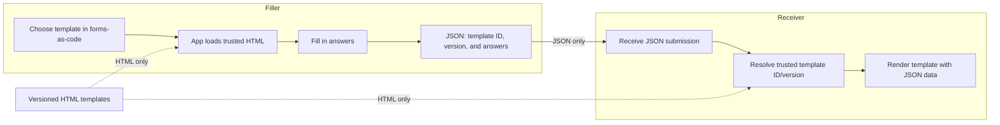

# forms-as-code

**Forms as code. Submissions as data.**

## [Open the forms-as-code web app](https://ivanchubb.github.io/forms-as-code/)

forms-as-code is an open-source experiment in data-first forms. A form's presentation is an HTML template; a completed submission is structured JSON that identifies the template and version needed to render it. The goal is to make forms easier to automate, validate, share in bulk, and sign.

## Repository status

The submission format remains a draft without a compatibility guarantee.
The static browser app discovers templates through ordered remote catalogs and browser-local sources, and supports editing, validation, save/load, bulk CSV/ZIP, and printing.
There is not yet a signing implementation or production interoperability guarantee.
See [`docs/format.md`](docs/format.md) for the current contract and open design questions.

## What's here

- [`.agents/skills/pdf-to-forms-as-code/SKILL.md`](.agents/skills/pdf-to-forms-as-code/SKILL.md) - repeatable workflow for adding one HTML template from a supplied PDF.
- [`assets/forms-as-code-base.css`](assets/forms-as-code-base.css) - common presentation styles loaded by the app.
- [`app/`](app/) - the single forms-as-code application: trusted HTML resolution, shared styling, data binding, validation, Save/Load/Lock, CSV, ZIP, and combined print workflows.
- [`app/site.config.json`](app/site.config.json) - neutral deployment branding and ordered default template catalogs.
- [`configs/army.json`](configs/army.json) - optional Army-branded deployment configuration kept outside the organization-agnostic renderer.
- The trusted Army form templates are maintained in the sibling [`../forms/`](../forms/) repository and discovered through its published catalog; forms-as-code does not store canonical form templates.
- [`spec/submission.schema.json`](spec/submission.schema.json) - draft JSON Schema for a forms-as-code submission envelope.

## Core idea

```text
forms-as-code app + one versioned HTML template + one JSON submission -> rendered form
```

A submission should carry answers, not a duplicate of the presentation. It must also identify the exact template version; a mutable URL alone is not sufficient for reliable re-rendering or signing. forms-as-code does not yet define a signing format. CAC/PIV support must be designed to interoperate with existing PKI and organizational requirements rather than inventing a proprietary signature scheme.

## Share data, not the whole form



Each form is one versioned HTML file with presentation markup, metadata, and `data-forms-as-code` bindings in the sibling `forms` repository.
When opening a submission, the app resolves the template ID and version through its validated sources and fetches only the catalog-approved HTML path from the catalog's origin.
The template cannot load arbitrary scripts, stylesheets, or assets.
The JSON submission carries its template reference and answers, not a duplicate of the presentation.

## Creating a form template

Read the complete [template authoring contract](docs/format.md#template-authoring-contract) before adding a form.
At minimum, a loadable template needs non-empty `template-id`, `template-version`, and `form-code` metadata, a `<form data-forms-as-code-form>` container, and bound controls.
Authors should also provide `form-title`, `form-edition`, and a consistent document title.
Missing display metadata produces a warning and fallback display, while missing identity metadata makes only that template unusable.
Templates must be self-contained and cannot contain scripts or load external assets.
The canonical `forms` repository applies stricter publication checks and requires all five metadata fields plus `<title>`.

## Deployment configuration

Hosts can customize the site without changing application code through a JSON configuration file.
Production static hosts should deploy their selected file as `site.config.json` alongside `app.js`.
For local development, `serve.sh [config.json]` serves the selected file at that URL without copying or modifying it.
With no argument, it uses the default blue theme from `app/site.config.json`.
The `siteName`, `tagline`, and `footer` properties set visible branding.
The renderer has a neutral blue default and no organization-specific theme names.
An optional `appearance` object can override light and dark presentation colors for another organization.
The Army example uses the green and gold palette from the Army Publishing application.
The optional `favicon` property accepts an app-relative or same-origin `.svg`, `.png`, or `.ico` URL and defaults to `./branding/favicon.svg`.
Cross-origin and embedded data favicons are rejected.

The `catalogs` property is an ordered, non-empty list:

```json
{
  "siteName": "Community Forms",
  "tagline": "Forms and submissions for Example County.",
  "footer": "Official service of Example County.",
  "appearance": {
    "primary": "#234f33",
    "primaryDark": "#173622",
    "accent": "#e0a92f"
  },
  "catalogs": [
    { "label": "County forms", "url": "https://forms.example.gov/catalog.json" },
    { "label": "Shared forms", "url": "https://shared.example.gov/catalog.json" }
  ]
}
```

Catalogs earlier in the list take precedence when multiple catalogs contain the same template ID and version.
A user's saved source list remains their browser-specific override of deployment defaults.
Invalid or unavailable configuration falls back to the built-in default configuration so the application remains usable.

### Hosting remote catalogs

A remote source is provider-independent: it is an HTTPS URL to a forms-as-code catalog, not an integration with a particular storage API.
Catalogs and templates can therefore be hosted by Amazon S3, Azure Blob Storage, Google Cloud Storage, a CDN, or a conventional web server.
Users can also add any compatible public catalog URL through **Add remote source** in the application menu.

Typical catalog URLs include:

```text
https://example-bucket.s3.us-east-1.amazonaws.com/catalog.json
https://example.blob.core.windows.net/forms/catalog.json
https://storage.googleapis.com/example-forms/catalog.json
https://forms.example.gov/catalog.json
```

The host must meet these requirements:

- `catalog.json` and every referenced HTML template must be publicly readable over HTTPS.
- The storage service must allow the forms-as-code site origin through CORS for `GET` requests.
- Template paths must resolve to the same origin as their catalog.
- Template paths must end in `.html`; redirects do not relax origin validation.
- Catalog responses should use `application/json`, and template responses should use `text/html`.

For example, a deployment at `https://forms.example.gov` must be included as an allowed CORS origin by the catalog and template host.
Using `*` may be appropriate for intentionally public, credential-free catalogs, but a specific site origin is more restrictive.
The app fetches cross-origin catalogs and templates without credentials.
Private buckets, authentication headers, expiring signed URLs, and provider-specific SDK credentials are not currently supported.
Private deployments should place an authenticated catalog service or same-origin proxy in front of storage rather than exposing credentials in `site.config.json`.

## Development

Run the local forms-as-code app from the workspace root so the app can fetch sibling-repository forms.
The server must run from `/home/chubb`, not from the `forms-as-code` directory, because templates are maintained in the sibling `forms` repository:

```sh
cd /home/chubb
python3 -m http.server 8000 --bind 127.0.0.1
```

Alternatively, run the included helper from the forms-as-code directory with the default blue configuration:

```sh
./serve.sh
```

Provide another configuration file to change the deployment presentation:

```sh
./serve.sh configs/army.json
```

The helper prints the selected configuration and application URL.
It serves the configuration virtually, without overwriting `app/site.config.json`.
Set `PORT` to override port 8000:

```sh
PORT=8080 ./serve.sh configs/army.json
```

Open <http://localhost:8000/forms-as-code/app/>.
Start a blank template or open a JSON submission.
The app uses a trusted allowlist and fetches only the referenced HTML template.
This prototype has no build system or third-party runtime dependencies.

### Print a CSV as one PDF

Choose the form template, select **Bulk CSV** to download its form-specific CSV, and add one record per row.
Select **Print CSV** and choose the completed CSV.
The app validates every row, renders the records locally, and opens the browser print dialog.
Choose **Save as PDF** to create one PDF containing all records, with a page break between records.
Blank rows and the untouched reference row are ignored.
A batch may contain up to 1,000 records, although large or complex batches can require substantial browser memory.
CSV contents are processed in the browser and are not sent to a server by this workflow.

## License

Not selected yet. Choose a license before accepting contributions or distributing the project.
