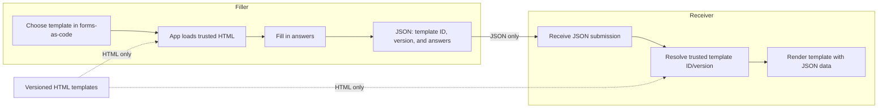

# forms-as-code

**Forms as code. Submissions as data.**

## [Open the forms-as-code web app](https://ivanchubb.github.io/forms-as-code/)

forms-as-code is an open-source experiment in data-first forms. A form's presentation is an HTML template; a completed submission is structured JSON that identifies the template and version needed to render it. The goal is to make forms easier to automate, validate, share in bulk, and sign.

## Repository status

Early scaffold. The submission format is a draft; the local forms-as-code app supports only the DA Form 5960 and DA Form 705-AFT templates. There is not yet a production-grade renderer, signing implementation, or compatibility guarantee. See [`docs/format.md`](docs/format.md) for the current model and open design questions.

## What's here

- [`.agents/skills/pdf-to-forms-as-code/SKILL.md`](.agents/skills/pdf-to-forms-as-code/SKILL.md) — repeatable workflow for adding one HTML template and one JSON example from a supplied PDF.
- [`assets/forms-as-code-base.css`](assets/forms-as-code-base.css) — common presentation styles loaded by the app.
- [`app/`](app/) - the single forms-as-code application: trusted HTML resolution, shared styling, data binding, validation, Save/Load/Lock, CSV, ZIP, and combined print workflows.
- The trusted Army form templates are maintained in the sibling [`../forms/`](../forms/) repository and loaded by URI/path through the app allowlist; forms-as-code does not store form templates.
- [`examples/da-form-5960.json`](examples/da-form-5960.json) and [`examples/da-form-705-aft.json`](examples/da-form-705-aft.json) — synthetic forms-as-code submission examples.
- [`spec/submission.schema.json`](spec/submission.schema.json) — draft JSON Schema for a forms-as-code submission envelope.
- [`docs/forms/`](docs/forms/) — source notes, conversion adaptations, and limitations for the two Army form examples.

## Core idea

```text
forms-as-code app + one versioned HTML template + one JSON submission -> rendered form
```

A submission should carry answers, not a duplicate of the presentation. It must also identify the exact template version; a mutable URL alone is not sufficient for reliable re-rendering or signing. forms-as-code does not yet define a signing format. CAC/PIV support must be designed to interoperate with existing PKI and organizational requirements rather than inventing a proprietary signature scheme.

## Share data, not the whole form



Each form is one versioned HTML file with its presentation markup, metadata, and `data-forms-as-code` bindings in the sibling `forms` repository. forms-as-code stores only the trusted URI/path registry and application logic. When opening a submission, the app resolves the template ID/version through a trusted allowlist and fetches only that HTML file; the template cannot load arbitrary scripts, stylesheets, or assets. The JSON submission carries its template reference and answers, not a duplicate of the presentation.

## Development

Run the local forms-as-code app from the workspace root so the app can fetch sibling-repository forms.
The server must run from `/home/chubb`, not from the `forms-as-code` directory, because templates are maintained in the sibling `forms` repository:

```sh
cd /home/chubb
python3 -m http.server 8000 --bind 127.0.0.1
```

Alternatively, run the included helper from the forms-as-code directory:

```sh
./serve.sh
```

Open <http://localhost:8000/app/>.
Start a blank template, open a JSON submission, or use a same-origin direct link such as <http://localhost:8000/app/?submission=../examples/da-form-705-aft.json>.
The app uses a trusted allowlist and fetches only the referenced HTML template.
This prototype has no build system or third-party runtime dependencies.

### Print a CSV as one PDF

Choose the form template, select **Bulk CSV** to download its form-specific CSV, and add one record per row.
Select **Print CSV** and choose the completed CSV.
The app validates every row, renders the records locally, and opens the browser print dialog.
Choose **Save as PDF** to create one PDF containing all records, with a page break between records.
Blank rows and the untouched example row are ignored.
A batch may contain up to 1,000 records, although large or complex batches can require substantial browser memory.
CSV contents remain in the browser and are not uploaded by this workflow.

## License

Not selected yet. Choose a license before accepting contributions or distributing the project.
